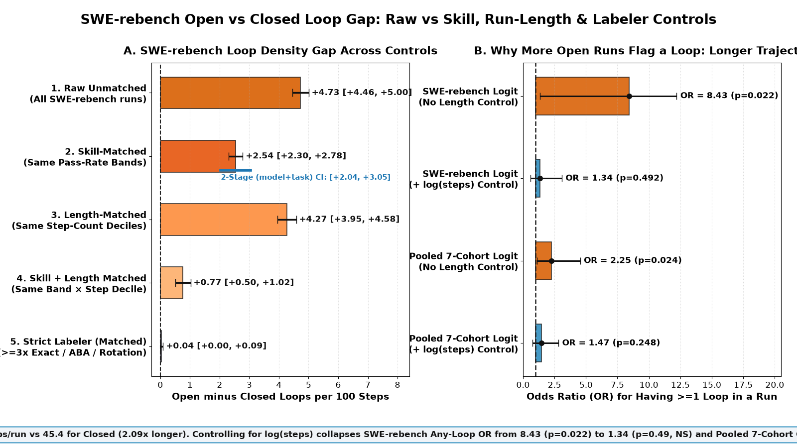
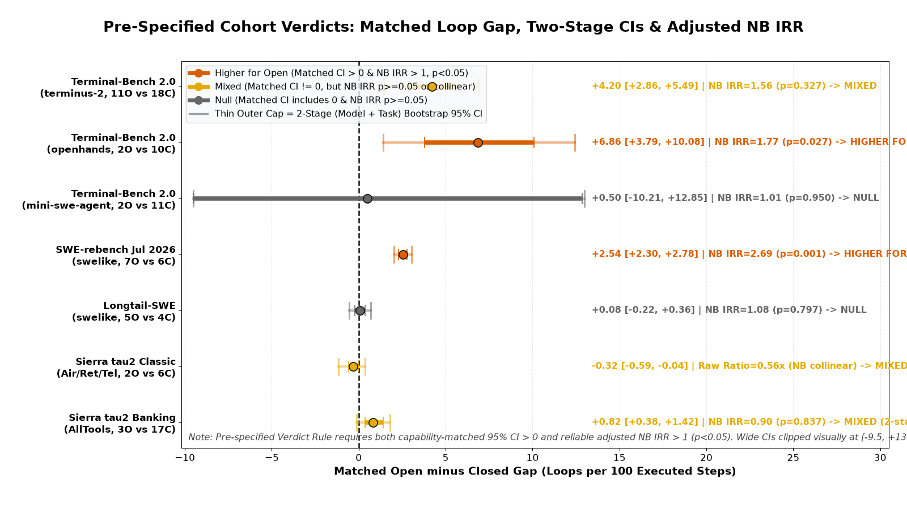
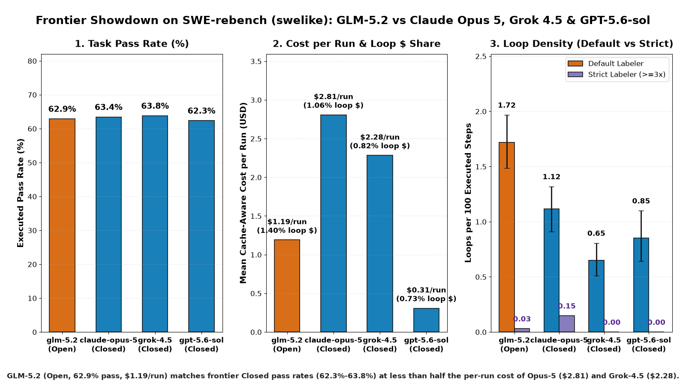
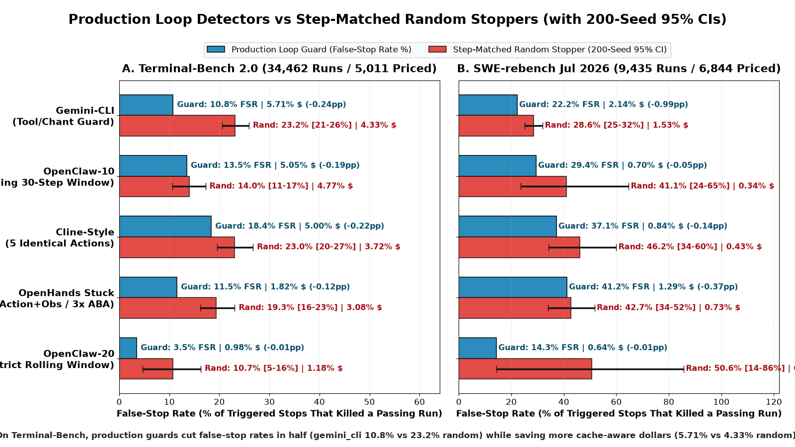
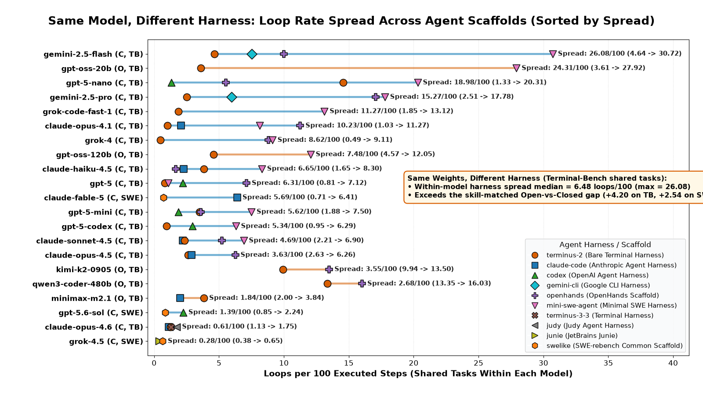

# Do open-weight agents loop more? What 56,797 uniform-scaffold trajectories actually show

Put the same model weights inside two different agent harnesses on the same coding tasks, and its loop rate often swings more than the gap between open-weight and closed frontier models.[^1] Across Terminal-Bench 2.0 and SWE-rebench, running identical weights across scaffolds shifts loop density by a median of **6.48 loops/100 steps** on Terminal-Bench—and up to **26.08** on `gemini-2.5-flash` (`4.64` in `terminus-2` vs `30.72` in `mini-swe-agent`) and **24.31** on `gpt-oss-20b`—while the capability- and length-matched gap between open and closed models on SWE-rebench is just **+0.77 loops/100** (`95% CI [+0.50, +1.02]`).[^1][^2]

We audited **56,797 executed uniform-scaffold trajectories** (`68,056` step-logged runs total) across Terminal-Bench 2.0, SWE-rebench, Longtail-SWE, and Sierra's τ²-bench using a deterministic step labeler, cache-aware billing reconstruction, and counterfactual loop-detector replay.[^3][^8]

## 1. The Raw Gap Looks Huge—Until You Inspect Who Ran What

Naive averages on standard scaffolds make open-weight models look far more prone to looping.[^3] On Terminal-Bench `terminus-2` (`11` open vs `18` closed models across `85` tasks), open models average **6.91** vs **2.69** loops/100 (unmatched gap **+4.22**).[^3] On SWE-rebench `swelike` (`7` open vs `6` closed models across `111` tasks), open models average **5.71** vs **0.98** loops/100 (gap **+4.73**), with **89.3%** of open runs flagging at least one loop vs **30.0%** of closed runs.[^3]

Three confounders inflate those raw gaps:[^3]
1. **Capability mismatch**: Leaderboards pair `3%–20%` pass-rate open models (`gpt-oss-20b`, `gpt-oss-120b`) against `58%–65%` closed models; failing runs repeat broken commands until the turn cap.
2. **Longer open-weight runs**: On SWE-rebench `swelike`, open models average **94.7** steps/run vs **45.4** for closed (`2.09x` longer), doubling exposure to binary per-run loop flags.[^2]
3. **Hidden harness and tool differences**: Proprietary entries (`claude-code`, `codex`, `gemini-cli`, `cursor`, `junie`) bundle custom loop guards, while Sierra's `banking_knowledge` folder mixes four retrieval toolsets (`AllTools`, `terminal_use`, `openai_embeddings`, `qwen_embeddings`).[^3]

## 2. Controlling for Skill, Run Length, Labeler Strictness, and Model Sampling

Matching open and closed models inside identical pass-rate bands (`<25%`, `25–40%`, `40–55%`, `55–75%`, `>=75%`) on the same scaffold and tasks cuts the SWE-rebench gap nearly in half, from **+4.73** to **+2.54** loops/100 (`1-stage task CI [+2.30, +2.78]`).[^3] Matching simultaneously on pass-rate band and step-count decile trims it to **+0.77** (`[+0.50, +1.02]`), and trims Terminal-Bench `terminus-2` from **+4.22** to **+0.99** (`[+0.62, +1.29]`).[^2]

Trajectory length explains almost the entire binary gap in *"runs with at least one loop."* In a run-level logistic regression with task fixed effects and two-way `(model, task)` cluster-robust SEs, open-weight status has an odds ratio of **8.43** (`p=0.022`) on SWE-rebench and **2.25** (`p=0.024`) pooled across all seven cohorts.[^2][^3] Adding `log(steps)` collapses the SWE-rebench odds ratio to **1.34** (`p=0.49`) and the pooled odds ratio to **1.47** (`p=0.25`)—both indistinguishable from `1.0`.[^2][^3]

Under one pre-specified verdict rule—**"higher for open"** only if the matched-gap 95% CI excludes zero *and* the adjusted Negative Binomial `IRR` is reliable with `p < 0.05`—both 1-stage task and 2-stage `(model, task)` bootstraps show only **`swe_rebench_swelike`** (matched gap `+2.54`, 2-stage `CI [+2.04, +3.05]`, NB `IRR=2.69, p=0.0014`) and **`tb_openhands`** (`+6.86`, 2-stage `CI [+1.40, +12.43]`, NB `IRR=1.77, p=0.027`) clear both bars.[^4] Terminal-Bench `terminus-2` (`+4.20`, 2-stage `CI [+1.44, +6.88]`, NB `IRR=1.56, p=0.33`) is **"mixed"**, while `tb_mini_swe_agent` (`+0.50`, NB `IRR=1.01, p=0.95`) and `longtail_swe_swelike` (`+0.08`, NB `IRR=1.08, p=0.80`; closed models used `1M` context vs `262K` for 4 of 5 open models) are **"null"**.[^3][^4] Sierra `tau2_classic` (`-0.32` matched) and `tau2_banking_knowledge_alltools` (`-1.13` unmatched, `+0.82` matched, NB `IRR=0.90, p=0.84`) move from **"mixed"** (1-stage) to **"null"** under the 2-stage bootstrap (`1.75x–2.66x` wider CIs).[^4]

We also audited 40 random flagged runs (`audit/flagged_samples.md`) and tested a **strict labeler** keeping only exact commands repeated `>=3` times consecutively, A-B-A thrashing (`>=3` cycles), and period-`k` rotations—dropping single 2-step repeats, near-duplicates, redundant re-reads, and error streaks.[^5][^6] Under strict rules, SWE-rebench loop density falls `~98%` in both groups—to **0.13** vs **0.02** loops/100 (`Open` vs `Closed`), shrinking the matched gap to **+0.04** (`1.12` vs `0.67` unmatched, `+0.52` matched on TB).[^6] Moreover, **47.6%** of open-weight `exact_loop` steps on SWE-rebench (`48.7%` for closed) are read-only checks (`git diff/status/log`, `grep/cat/ls`, read tools, or unchanged `pytest`).[^7]

In dollar terms (`6,844` cost-validated SWE-rebench runs), pooled loop spend is **2.87% ($215.10 / $7,506.20)** because expensive closed runs dominate spend, while within `swe_rebench_swelike` open models spend **5.20%** of dollars in loops vs **1.14%** for closed.[^3][^8] Among SWE-rebench `swelike` frontier peers, open-weight `glm-5.2` hits **62.9%** pass at **$1.19/run** (`1.72` loops/100; `1.40%` loop dollars), matching `claude-opus-5` (**63.4%**, **$2.81/run**, `1.12` loops/100), `grok-4.5` (**63.8%**, **$2.28/run**, `0.65` loops/100), and `gpt-5.6-sol` (**62.3%**, **$0.31/run**, `0.85` loops/100).[^3][^6]

## 3. Production Loop Detectors Beat Random Stopping on Precision and Savings

Replaying `gemini_cli`, `openclaw_10` (30-step sliding window), `cline_style` (5 identical actions), and `openhands_stuck` against 200-seed step-matched random stoppers shows:[^9]
- **Terminal-Bench 2.0**: `gemini_cli` halves the false-stop rate (`FSR`, stopped runs that would have passed)—**10.77%** vs **23.18%** (`95% CI [20.51%, 25.90%]`) random—saving **5.71% ($190.06)** vs **4.33%** random (`0.24 pp` pass loss). `openclaw_10` saves **5.05% ($168.28)** at **13.49% FSR** (`0.19 pp` loss), and `cline_style` saves **5.00% ($166.68)** at **18.38% FSR** vs **23.05%** random.[^9]
- **SWE-rebench**: `gemini_cli` saves **2.14% ($160.74)** vs **1.53%** (`[1.28%, 1.97%]`) random, with **22.20% FSR** vs **28.60%** (`[25.04%, 31.99%]`) random. Adjacent-step guards (`cline_style`) miss **82.9% (`277/334`)** of `period_k_rotation` cycles on TB and **98.3% (`118/120`)** on SWE-rebench—making sliding-window memory (`openclaw_10`) essential.[^8][^9]

## 4. Same Model, Different Harness: Scaffolds Move Loop Rates as Much as Weights

Models evaluated across multiple scaffolds on shared tasks (`results/same_model_across_harness.csv`) show that swapping the harness while holding weights and tasks fixed shifts looping dramatically:[^1]
- **`gemini-2.5-flash` & `gemini-2.5-pro` (Closed, TB)**: `gemini-2.5-flash` jumps from **4.64** loops/100 (`terminus-2`) and **7.51** (`gemini-cli`) to **10.01** (`openhands`) and **30.72** (`mini-swe-agent`, **26.08** spread); `gemini-2.5-pro` spans **2.51–17.78** (**15.27** spread).[^1]
- **`gpt-5`, `gpt-5-nano` & `claude-fable-5` (Closed, TB & SWE)**: `gpt-5` rises from **0.81** (`terminus-2`) to **2.20** (`codex`) and **7.12** (`openhands`, **6.31** spread), `gpt-5-nano` spans **1.33–20.31** (**18.98** spread), and `claude-fable-5` jumps from **0.71** (`swelike`) to **6.41** (`claude-code`, **5.69** spread).[^1]
- **`gpt-oss-20b`, `gpt-oss-120b` & `minimax-m2.1` (Open, TB)**: `gpt-oss-20b` jumps from **3.61** (`terminus-2`) to **27.92** (`mini-swe-agent`, **24.31** spread) and `gpt-oss-120b` from **4.57** to **12.05** (**7.48** spread), while `minimax-m2.1` drops from **3.84** (`terminus-2`) to **2.00** (`claude-code`).[^1]

Part of this spread reflects step-logging granularity: `terminus-2` batches multi-command shell turns, whereas `claude-code` and `mini-swe-agent` log per-tool steps (and raw `openhands` pairs action and observation events collapsed before scoring).[^1]

## 5. Inside the Google Gemini Family

Binary "open vs closed" labels also hide wide spread inside one vendor:[^3][^10]
- On Terminal-Bench `terminus-2`, **`gemini-2.5-flash`** (`17.9%` pass) averages **4.68 loops/100** (`14.8%` looping) and **`gemini-2.5-pro`** (`33.4%` pass) averages **2.49**, while **`gemini-3-flash-preview`** (`52.6%` pass) averages **4.53** and **`gemini-3-pro-preview`** (`58.8%` pass) drops to **0.94** (`6.8%` looping).[^3] On `terminus-3-3`, **`gemini-3.1-pro-preview`** (`74.2%` pass) reaches **0.64 loops/100**.[^10]
- On Sierra τ²-bench, `gemini-3-pro` (`0.15`/100, `84.8%` pass) and `gemini-3-flash` (`1.92`/100, `80.9%` pass) are disciplined on `tau2_classic`. On `banking_knowledge` (`AllTools`), `gemini-2.5-pro` (`2.91`/100) and `gemini-3.1-pro-preview` (`7.80`/100) beat Sierra's shell-only `terminal_use` scaffold (`10.03` and `16.16` loops/100 for `gemini-3-flash` and `gemini-3-pro`).[^3][^10]

## 6. Limitations and Audit Diagnostics

1. **Finite model sample size**: Cohorts contain `2–11` open and `4–18` closed models; 2-stage `(model, task)` bootstraps capture model-sampling variance.[^4]
2. **Regression collinearity in `tau2_classic`**: Phase 2 reported NB `IRR = 0.03` (`p=0.017`) on `tau2_classic` despite raw rates of **0.42** (Open) vs **0.76** (Closed) loops/100 (**0.56x** raw ratio).[^4][^11] Both open models released in Feb 2026 (`month=13`), while all six closed models released in Sep–Dec 2025 (`months=8..11`), where Dec closed models looped more than Sep/Nov Claude models (`IRR=3.11/month`). Dropping `release_months` restores NB `IRR` to **0.60** (`p=0.392`), matching the `0.56x` raw ratio.[^11]
3. **Terminal-Bench cost exclusions (`n<100` suppression)**: Our `[0.50x, 2.00x]` filter kept `5,011` TB runs (**800** closed) and dropped `24,543` mismatches (median RSC ratio `0.12x`).[^12] Exactly `23,076` of `24,543` dropped runs (`94.0%`) contain Next.js RSC `$<hex>` pointers (`$3b`, `$4a`) in `tbench.ai` exports replacing multi-KB outputs with 3-byte strings—not a `cost_cents / 100` or `cache_tokens` bug.[^12] Cells with `<100` cost-valid runs are suppressed as `n<100`.[^3]
4. **Missing Terminal-Bench step traces**: `17,642` of `52,104` TB rows have `steps = null`, including `gpt-5.3-codex@openai` (`75.1%` pass), `kimi-k2.5@kimi` (`65.5%`), and `glm-4.7@z-ai` (`62.0%`).[^13]

> ### Method Box: Labels, Matching & Regression Specifications
> - **Default vs Strict Labeler**: Normalization strips ANSI codes, timestamps, UUIDs, and temp paths. The default 6-class labeler flags `exact_loop`, `near_duplicate`, `aba_thrash`, `period_k_rotation (k<=5)`, `error_streak (>=4)`, and `redundant_reread` while excluding `productive_repeat`. The strict labeler keeps only `>=3` consecutive `exact_loop` steps, `>=3`-cycle `aba_thrash`, and `period_k_rotation`.[^6]
> - **Matching & Uncertainty**: Executed runs (`n_steps >= 1`) on shared tasks are stratified into five pass-rate bands and ten step-count deciles (`D0..D9`), weighted by `min(N_open, N_closed)`.[^2][^3] We report 1-stage task and 2-stage `(model, task)` bootstraps (`1,000` replicates), plus Negative Binomial and Logistic GLMs (`has_any_loop` with/without `log1p(steps)`) with task fixed effects and two-way `(model, task)` cluster-robust SEs.[^4]

---

### Footnotes & Data Provenance
[^1]: [`results/same_model_across_harness.csv`](results/same_model_across_harness.csv), [`assets/harness_dumbbell.png`](assets/harness_dumbbell.png).
[^2]: [`results/length_matched_comparison.csv`](results/length_matched_comparison.csv), [`results/length_decile_breakdown.csv`](results/length_decile_breakdown.csv), [`assets/hero_raw_vs_controlled.png`](assets/hero_raw_vs_controlled.png).
[^3]: [`results/loops_by_model_scaffold.csv`](results/loops_by_model_scaffold.csv), [`results/open_vs_closed_summary.csv`](results/open_vs_closed_summary.csv), [`results/open_vs_closed_model.md`](results/open_vs_closed_model.md).
[^4]: [`results/cohort_verdicts.csv`](results/cohort_verdicts.csv), [`results/two_stage_bootstrap_comparison.csv`](results/two_stage_bootstrap_comparison.csv), [`assets/cohort_verdicts.png`](assets/cohort_verdicts.png).
[^5]: [`audit/flagged_samples.md`](audit/flagged_samples.md).
[^6]: [`results/strict_vs_default_labeler.csv`](results/strict_vs_default_labeler.csv), [`results/strict_vs_default_by_model.csv`](results/strict_vs_default_by_model.csv), [`assets/glm52_vs_opus5.png`](assets/glm52_vs_opus5.png).
[^7]: [`results/readonly_exact_loops.csv`](results/readonly_exact_loops.csv).
[^8]: [`results/study_metrics.json`](results/study_metrics.json), [`results/summary.md`](results/summary.md).
[^9]: [`results/tb_detectors.csv`](results/tb_detectors.csv), [`results/swe_detectors.csv`](results/swe_detectors.csv), [`assets/detectors_vs_random.png`](assets/detectors_vs_random.png).
[^10]: [`results/gemini_by_harness_model.csv`](results/gemini_by_harness_model.csv), [`results/gemini_report.md`](results/gemini_report.md), [`results/open_vs_closed_model.md`](results/open_vs_closed_model.md).
[^11]: [`results/tau2_classic_irr_diagnosis.json`](results/tau2_classic_irr_diagnosis.json).
[^12]: [`results/tb_cost_rebuild_audit.csv`](results/tb_cost_rebuild_audit.csv), [`audit/tb_cost_rebuild_audit.md`](audit/tb_cost_rebuild_audit.md).
[^13]: [`results/tb_null_step_models.csv`](results/tb_null_step_models.csv).
